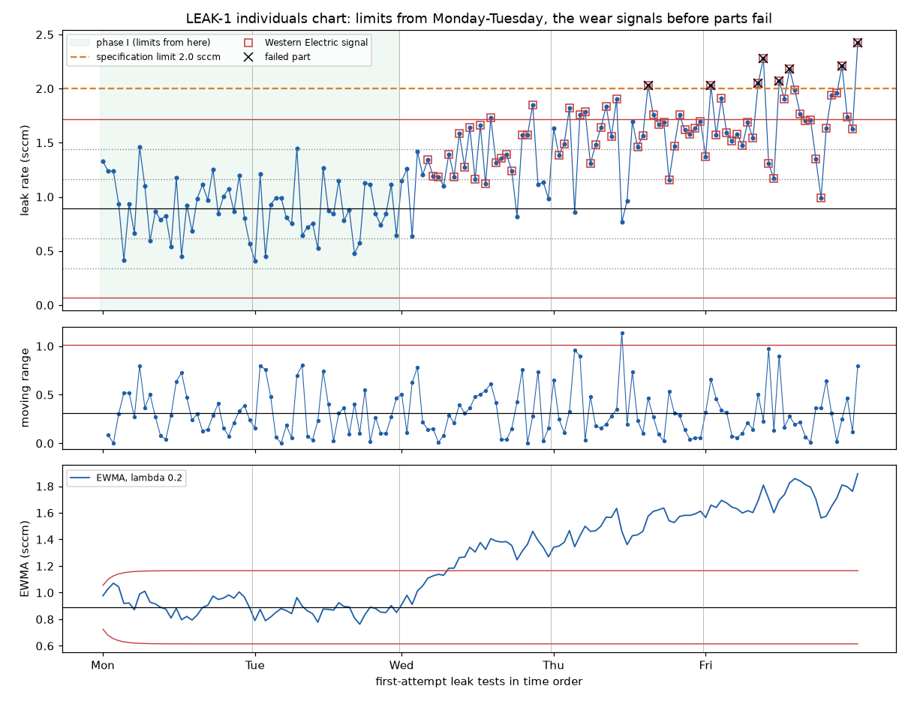
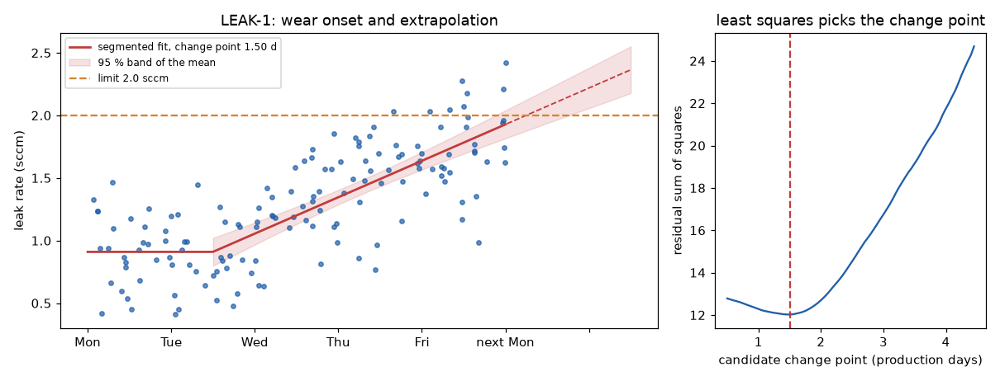

# Production-Test SPC

[](https://github.com/HannaBeshoy/production-test-spc/actions/workflows/ci.yml)

**Applied Statistics course project** · University of Debrecen, Faculty of Informatics · Python, NumPy, SciPy, pandas · **complete: 48 tests in CI; data from the production-test-db project**

One week of end-of-line test data from a small bearing, clutch and actuator line, the same week as in my [production-test database](https://github.com/HannaBeshoy/production-test-db). The database project found the problems with SQL. This project asks the statistical questions behind them: is a difference real or chance, how sure are we, and **could the problem have been caught before parts failed?**

- [x] Descriptive statistics, normality checks (Shapiro-Wilk, Q-Q plots) and confidence intervals for means, standard deviations and proportions (Wilson)
- [x] Hypothesis tests written out from the formulas: Welch and pooled t, paired t, F, Mann-Whitney, one-way ANOVA, Levene, Kruskal-Wallis, chi-square, two-proportion z; each checked against SciPy
- [x] Regression with confidence and prediction bands, Pearson correlation, and a **segmented regression that finds when the wear started**
- [x] Control charts: individuals and moving range, Xbar-R, p-chart, EWMA, with the four Western Electric run rules
- [x] Process capability (Cp, Cpk, Pp, Ppk) **with confidence intervals**, and the sample size a reliable Cpk needs
- [x] Tests check the statistics themselves: SciPy agreement, control-chart constants by simulation, and the 95 % coverage of every confidence interval



## What the statistics add to the database findings

| Question | Method | Answer |
| --- | --- | --- |
| Could LEAK-1's seal wear have been caught earlier? | I-MR chart with limits from Mon-Tue, run rules, EWMA | **Yes, on Wednesday at 09:08** (run rule 3), more than a day before the first failed part (Thursday 15:50). The plain 3-sigma rule alone reacts only at 16:17 on Wednesday |
| Is the rise real? | Welch t, Mann-Whitney, ANOVA, Tukey HSD | +0.76 sccm from Mon-Tue to Thu-Fri, 95 % CI 0.65 to 0.87, p < 0.0001; the day explains 60 % of the variation |
| When did it start, where is it going? | segmented regression, slope CI | change point Tuesday afternoon (true start: Wednesday 06:00); +0.29 sccm per day; the mean reaches the 2.0 sccm limit around next Monday morning |
| How capable is the leak test now? | Cpk with Bissell CI | Cpk 1.29 on Monday, **0.30 on Friday** (95 % CI 0.16 to 0.44) |
| Is LEAK-1 really worse than the others? | Wilson CIs, Fisher's exact test | yes (p = 0.02), but the intervals of the five stations overlap; pass/fail counts are a weak signal |
| Is Friday's clutch yield drop real? | two proportions, Fisher | 73.3 % vs 94.2 %, p = 0.003 |
| Does the shift matter? | chi-square of independence | no evidence (p = 0.25), with the honest caveat that so few failures can only reveal large effects |
| Are the retests honest? | Welch t | retests read 0.67 sccm lower than first attempts on the same days, like an unworn seal: re-seating hides the wear |
| Is the torque process stable? | Xbar-R | no signals all week: the chart also stays quiet when nothing happens |

The full report with every number: [results/report.md](results/report.md).



## Honest limits

- The data is **generated** (a fixed-seed simulation of a week, from the database project) with deliberately wide spreads: most Cpk values are below 1.33. The methods are the point, not the absolute numbers.
- The change point comes out half a shift early: the model fits a straight line to what is really a daily staircase in the generator.
- The extrapolation to "next Monday" assumes the wear stays linear: a warning of days, not a maintenance schedule.
- Two quantities fail the normality test, each because of one extreme reading; the report shows both and what happens without them.

## Running it

```bash
python -m venv .venv && source .venv/bin/activate      # Windows: .venv\Scripts\activate
pip install -r requirements.txt
python analyse.py          # writes results/report.md, results/summary.json and docs/img/
python -m pytest -q        # 48 tests
```

The data in `data/` is exported by `tools/export_data.py` from the database project's generator. From the Oracle database itself, `sql/export_measurements.sql` produces the same table.

## Course core vs extensions

| Applied Statistics topic | Where |
| --- | --- |
| descriptive statistics, distributions, normality | `spc/stats.py` `describe`, `normal_qq`, `shapiro`; report section 1 |
| confidence intervals (mean, SD, proportion) | `ci_mean`, `ci_sd`, `ci_proportion`; sections 1, 2, 6 |
| one- and two-sample tests, F test, non-parametric tests | `welch_t`, `pooled_t`, `paired_t`, `f_test`, `mann_whitney`; section 4 |
| ANOVA and multiple comparisons | `anova_oneway`, `levene`, `kruskal_wallis`, Tukey HSD; section 4 |
| contingency tables, proportions | `chi2_independence`, `two_proportions`, Fisher; sections 6, 7 |
| correlation and linear regression | `pearson`, `linreg`; sections 5, 10 |
| **Extensions:** SPC charts and run rules, EWMA, capability with CIs, change-point regression | `spc/charts.py`, `spc/capability.py`, `hinge_fit` |

## Repository layout

```text
spc/stats.py          estimation, tests, regression (formulas written out)
spc/charts.py         I-MR, Xbar-R, p and EWMA charts, Western Electric rules
spc/capability.py     Cp, Cpk, Pp, Ppk with confidence intervals
analyse.py            the analysis: report, summary and figures
data/                 measurements.csv (1,380 rows), runs.csv (1,080 rows)
tools/export_data.py  exports the data from the production-test-db generator
sql/                  the same export as an Oracle query
results/              report.md, summary.json
tests/                SciPy agreement, simulation checks, the report's findings
docs/PROJECT_GUIDE.md how each method works and how to explain it
```

## Author

Beshoy Hanna · Computer Science Engineering BSc, University of Debrecen · [GitHub](https://github.com/HannaBeshoy) · [LinkedIn](https://linkedin.com/in/beshoy-hanna-8b52213a0)
